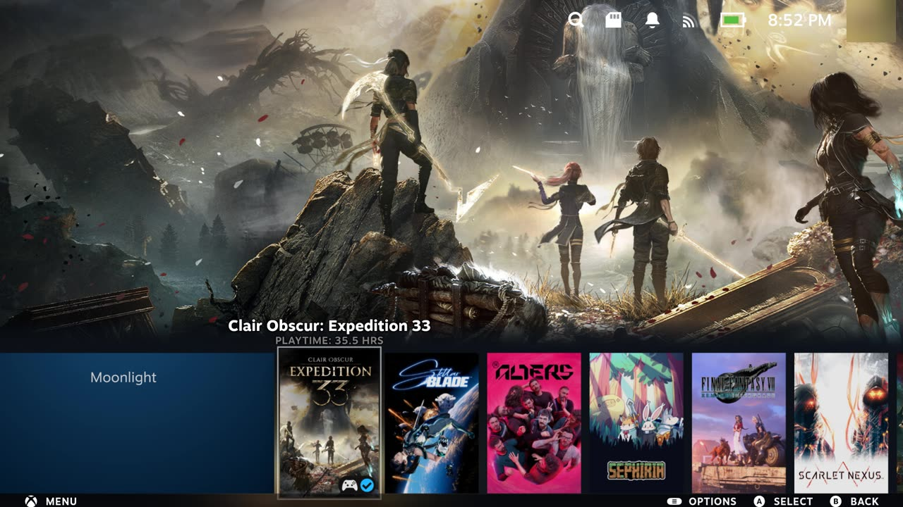
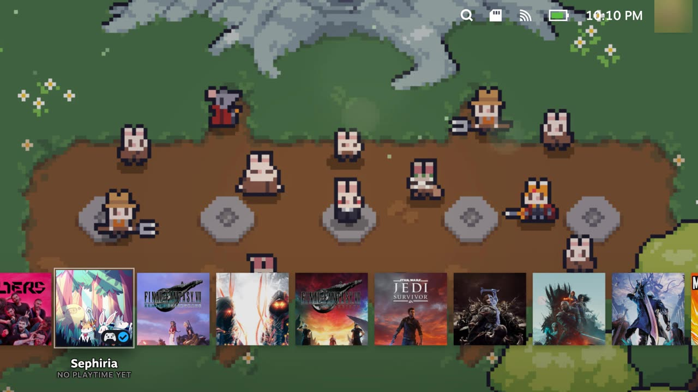
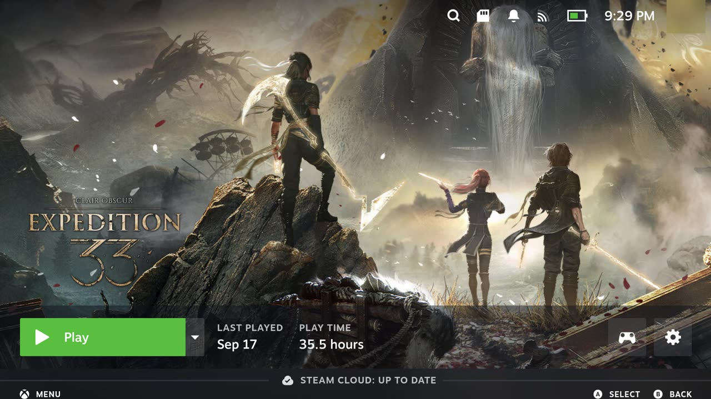
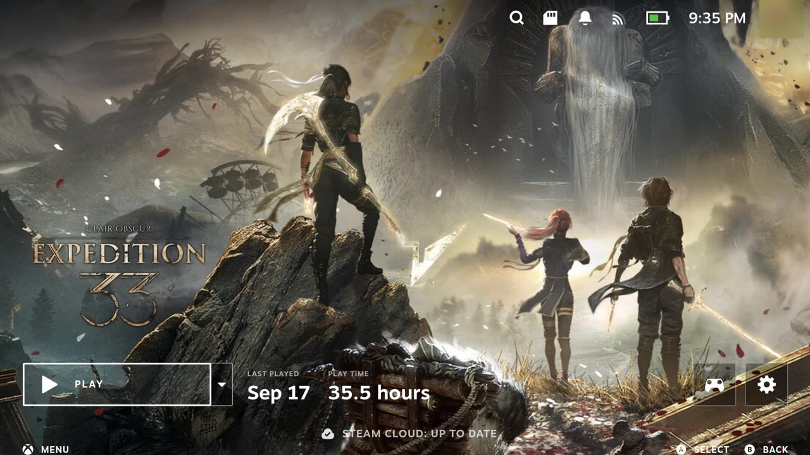

# SteamOS Better UI

> **WIP — trabajo en progreso.** Probado solo en una ROG Ally (Z1 Extreme) con Bazzite, a
> 1920x1080. Puede verse mal, o no aplicarse, en otras pantallas y tras cualquier
> actualizacion del cliente de Steam. Usalo bajo tu propio riesgo.

Un tema para el modo juego de Steam (SteamOS / Steam Deck, Bazzite, ROG Ally y otros
handhelds con Linux) inspirado en el concepto
[PlayStation 5 User Interface Concept](https://dribbble.com/shots/10863887-Playstation-5-User-Interface-Concept):
caratulas cuadradas, el arte del juego a pantalla completa y paneles de vidrio negro
(glassmorphism) en lugar de los grises y azules de Steam.

| Antes | Despues |
|---|---|
|  |  |
|  |  |

Mas capturas: [menu lateral](docs/capturas/menu-lateral.jpg) ·
[menu del juego](docs/capturas/menu-juego.jpg) · [busqueda y teclado](docs/capturas/teclado.jpg) ·
[ajustes](docs/capturas/ajustes.jpg)

## Que cambia

- **Home:** caratulas de recientes en cuadrado (tambien la del ultimo jugado), arte del juego a
  pantalla completa, titulo y tiempo de juego debajo del seleccionado, sin barra de botones.
- **Ficha del juego:** boton PLAY con contorno blanco, cifras grandes, arte a pantalla completa;
  secciones (Activity, Your stuff...) sobre el arte difuminado, con tarjetas de vidrio.
- **Menus:** menu lateral, menu de opciones del juego, menu en partida y acceso rapido en vidrio
  negro, con el foco como contorno blanco.
- **Resto:** barra superior y busqueda, teclado en pantalla, Ajustes, Controller Settings y
  botones de dialogo en general.

## Instalar

En el dispositivo, desde el modo escritorio (Konsole) o por SSH:

```bash
git clone https://github.com/andyeswong/steamos-better-ui.git
cd steamos-better-ui
./install.sh
```

Si es la primera vez, reinicia Steam (o el equipo) una vez. Despues el tema se aplica solo cada
vez que arranca el modo juego.

No hace falta root ni Decky Loader. El instalador:

1. Copia el tema y el inyector a `~/.local/share/steamos-better-ui`.
2. Activa la depuracion remota del cliente de Steam creando
   `~/.steam/steam/.cef-enable-remote-debugging`. El puerto (8080) escucha solo en
   `127.0.0.1`, no en la red.
3. Instala y arranca un servicio de usuario de systemd, `steamos-better-ui`, que mete los
   estilos en la interfaz de Steam y los vuelve a meter si Steam se reinicia.

Para quitarlo:

```bash
./uninstall.sh
```

Para la sesion y quita los estilos al momento. La depuracion remota solo se desactiva si la
activo el instalador.

Probar sin instalar nada (se pierde al reiniciar Steam):

```bash
python3 injector/sbu_injector.py --once     # aplicar
python3 injector/sbu_injector.py --remove   # quitar
```

## Como funciona

El modo juego de Steam es un conjunto de paginas web (CEF). El inyector
(`injector/sbu_injector.py`, solo biblioteca estandar de Python) se conecta al depurador de
CEF y añade un `<style>` por cada archivo de `theme/`:

- `theme/main/` — la ventana principal (home, ficha, busqueda, ajustes...).
- `theme/mainmenu/` — el menu lateral y el menu en partida.
- `theme/quickaccess/` — el menu de acceso rapido.

El servicio relee los CSS en cada pasada, asi que editar un archivo instalado se ve en un par
de segundos.

## Limitaciones conocidas

- **Clases ofuscadas.** Casi todos los selectores usan las clases generadas de Steam
  (`._1pwP4eeP1zQD7PEgmsep0W`). Una actualizacion del cliente puede cambiarlas y romper partes
  del tema.
- **Medidas fijas a 1080p.** La primera caratula del home se encoge con un corrimiento medido
  en la Ally (`theme/main/home-primero.css`). En la Steam Deck (1280x800) hay que remedirlo.
- **Acceso rapido cortado abajo.** Su ventana termina 40px antes del borde (Steam reserva ese
  espacio para la barra de botones); con CSS no se puede alargar.
- **Sin barra de botones.** Se oculto a proposito; se pierden las ayudas MENU / SELECT / BACK.
- Hay pantallas sin revisar (Biblioteca del menu, Propiedades, algunas secciones de Ajustes y del
  acceso rapido).

## Desarrollo

`dev/cdp.mjs` y `dev/cdpshot.mjs` (Node 22+) evaluan JS y sacan capturas de una pagina de Steam
a traves de un tunel SSH al puerto 8080 del dispositivo. `docs/bitacora.md` cuenta paso a paso
como se hizo cada parte, que fallo y por que.
